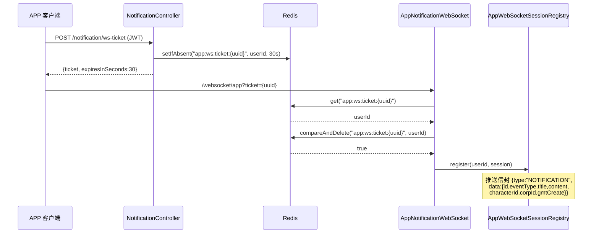
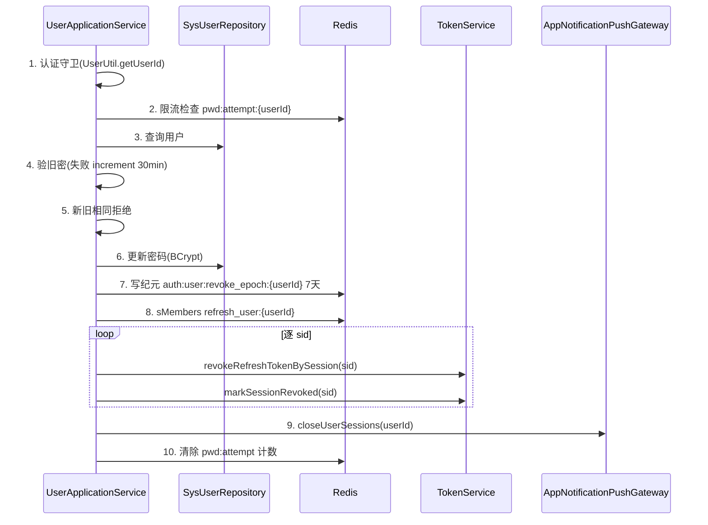

# 伴侣 APP 后端支撑端点全生命周期流程

> 面向开发者：理清伴侣 APP 六大能力（角色面板/技能成长、邮件收发、工业直查、团员追踪、APP 通知通道、账号自助+授权入口）从 REST 入口到 ESI/Redis/DB 的完整链路。
> 关联代码集中在 `interfaces/web/controller`（6 控制器）、`application/service`（5 应用服务）、`domain/service/system`（通知检测+建筑同步）、`infrastructure/external/appws`（WS 端点+注册表）、`infrastructure/persistence/repository/system/AppNotificationRepositoryImpl`。
> 特性工件：`specs/022-companion-api/`

## 1. 总览

伴侣 APP 后端为移动端提供六项能力，共 18 个 REST 端点 + 1 个 WebSocket 端点。采用既有 DDD 五层架构，领域层定义端口（`EsiGateway`/`CacheGateway`/`AppNotificationPushGateway`），基础设施层实现。通知系统为事件驱动：定时检测 → 判定 → 去重 → 入库 → 在线推送。

```
┌─────────────────────────────────────────────────────────────────────────────┐
│                        APP 客户端（移动端）                                  │
└──────────┬──────────────────────────────┬──────────────────────┬────────────┘
           │ REST 18 端点                  │ WS /websocket/app    │
           │ (JWT Bearer)                  │ (一次性 ticket)       │
┌──────────▼──────────────────────────────▼──────────────────────▼────────────┐
│  Spring Security(JWT 过滤器+RBAC)  →  Controller → ApplicationService       │
│                                                                              │
│  ┌──────────────────────────────────────────────────────────────────────┐   │
│  │  领域层：EsiGateway / CacheGateway / AuthorizeUtil / AppNotification │   │
│  │          DetectService / AppStructureSyncService                     │   │
│  └──────────────────────────────────────────────────────────────────────┘   │
│                          ↓                                                   │
│  ┌──────────────────────────────────────────────────────────────────────┐   │
│  │  基础设施：EsiApiService / Redis / MyBatis Plus / AppWebSocket       │   │
│  │            SessionRegistry / AppNotificationWebSocket                │   │
│  └──────────────────────────────────────────────────────────────────────┘   │
└─────────────────────────────────────────────────────────────────────────────┘
```

### 1.1 安全语义两层分工（T044 固化）

| 场景 | 出口 | 来源 |
|------|------|------|
| 未认证 / JWT 非法 | HTTP 401 + `AUT00210` | Spring Security 层 `JwtAuthorizationTokenFilter.rejectOrPass`（白名单外直写 401） |
| 跨属主访问他人数据 | HTTP 403 + `ACCESS_UNAUTHORIZED` | 应用层 `AuthorizeUtil.authorize` → `EveHelperException` → `GlobalExceptionHandler`（`ACCESS_UNAUTHORIZED` 映射 HTTP 403） |
| ESI 权限不足 | HTTP 403 + `ESI00403` | `EsiAccessException` → `GlobalExceptionHandler` |

> ⚠️ **防枚举**：他人通知 / 邮件标记已读返回 0 行时统一抛 `ACCESS_UNAUTHORIZED`，不泄露资源存在性。

---

## 2. 能力一：角色面板与技能成长（US1 / FR-001~003）

### 2.1 端点

| 方法 | 路径 | 关键参数 | 控制器 |
|------|------|----------|--------|
| GET | `/character/{characterId}/panel` | forceRefresh? | `CharacterPanelController.panel` |
| GET | `/character/{characterId}/skills` | forceRefresh? | `CharacterPanelController.skills` |
| GET | `/character/{characterId}/skill-queue` | forceRefresh? | `CharacterPanelController.skillQueue` |

### 2.2 调用链

```
CharacterPanelController
  → CharacterPanelApplicationService.panel/skills/skillQueue
    → AuthorizeUtil.authorize(characterId)  // 014 归属校验
    → EsiGateway 多方法直查（015 缓存判读）
    → 领域 VO → 响应 DTO
```

- **面板**：组合 ESI `character/public` + `online` + `location` + `ship` 四接口；建筑内位置以 `structureId` 表示（`stationId` 为 null）。
- **技能队列**：控制器层批量解析 `skillName`（`InvTypesService.getNameByTypeIds`），解析不到的 `skillId` 对应 null 不抛异常。空队列跳过解析。
- **forceRefresh**：透传至 015 缓存层，受 `ForceRefreshLimiter` 限流（每键 60 分钟窗 5 次）。

---

## 3. 能力二：邮件收发（US2 / FR-004~008）

### 3.1 端点

| 方法 | 路径 | 关键参数 | 控制器 |
|------|------|----------|--------|
| GET | `/mail/{characterId}/inbox` | lastMailId?, forceRefresh? | `MailController.inbox` |
| GET | `/mail/{characterId}/labels` | forceRefresh? | `MailController.labels` |
| GET | `/mail/{characterId}/{mailId}` | forceRefresh? | `MailController.detail` |
| PUT | `/mail/{characterId}/{mailId}/read` | `{read: true}` | `MailController.markRead` |
| POST | `/mail/{characterId}/send` | `{recipients, subject, body}` | `MailController.send` |
| POST | `/mail/recipients/resolve` | `{names:[...]}` | `MailController.resolveNames` |

### 3.2 调用链

```
MailController
  → MailApplicationService.inbox/labels/detail/markRead/send/resolveNames
    → AuthorizeUtil.authorize(characterId)  // 除 resolveNames 外
    → EsiGateway 邮件接口直查
```

- **收件箱**：ESI 原生 50 条/页 + `last_mail_id` 游标分页。
- **回信**：前端复用 send 端点（`recipient=原发件人，subject=Re: 原标题`）——后端不提供专用 reply 端点（YAGNI）。
- **名称解析**（`resolveNames`）：公开接口，不消耗角色授权，直接调 ESI `/universe/names`。未解析项 `resolved=false`。
- **发信权限**：ESI scope 不足时映射为「需重新授权」提示（021 scopes 语义）。

---

## 4. 能力三：工业订单直查（US3 / FR-009~010）

### 4.1 端点

| 方法 | 路径 | 关键参数 | 控制器 |
|------|------|----------|--------|
| GET | `/job/{type}/{id}` | status?, current?, size?, forceRefresh? | `JobController.getJobs` |

### 4.2 调用链

```
JobController.getJobs
  → IndustryJobQueryApplicationService.queryJobs(type, id, status, pageQuery, forceRefresh)
    → type="char": AuthorizeUtil.authorize(id)
    → type="corp": AuthorizeUtil.authorize(id) + CharacterRolesInfo.hasIndustryPermission()
       (Director / Accountant)
    → EsiGateway.queryCharacterIndustryJobs / queryCorporationIndustryJobs
    → status 内存过滤 + 分页
```

- **与 QQ 同步端点并行**：既有 `POST /job/{type}/{id}/{complete}` 不变（QQ 侧同步入库），本端点直查 ESI 不落库。
- **corp 权限**：`hasIndustryPermission()` 要求 Director 或 Accountant（`CharacterRolesInfo:62`）。

---

## 5. 能力四：军团团员追踪（US5 / FR-011~013）

### 5.1 端点

| 方法 | 路径 | 关键参数 | 控制器 |
|------|------|----------|--------|
| GET | `/corporation/{corpId}/member-tracking` | characterId（必填）, forceRefresh? | `MemberTrackingController.track` |

### 5.2 调用链

```
MemberTrackingController.track
  → MemberTrackingApplicationService.track(corpId, characterId, forceRefresh)
    → AuthorizeUtil.authorize(characterId)  // 014 归属
    → EsiGateway.queryCharacterRoles → hasDirectorRole()  // 仅 Director
    → EsiGateway.queryCorporationMemberTracking  // 直查不落库
    → 缓存按 userId 隔离（015 语义）
```

- **Director 校验**：`hasDirectorRole()` 精确要求 Director 角色（`Station_Manager` 单独不足，`CharacterRolesInfo:51`）。
- **online 派生**：服务端由 `logonDate > logoffDate` 计算。
- **缓存隔离**：键含 `userId`，不同用户查同一军团各自缓存。

---

## 6. 能力五：APP 通知通道（US4 / FR-014~020, 027~028）

### 6.1 REST 端点

| 方法 | 路径 | 关键参数 | 控制器 |
|------|------|----------|--------|
| GET | `/notification` | current?, size?, unreadOnly? | `NotificationController.page` |
| GET | `/notification/unread-count` | 无 | `NotificationController.unreadCount` |
| PUT | `/notification/{id}/read` | 无 | `NotificationController.markRead` |
| POST | `/notification/ws-ticket` | 无 | `NotificationController.wsTicket` |

### 6.2 WebSocket 端点

| 端点 | 认证方式 |
|------|----------|
| `/websocket/app` | 一次性 ticket（`?ticket=<uuid>`），30s 有效 |

### 6.3 通知事件类型与判定条件

三事件由 `AppNotificationDetectService` 定时检测（`@Scheduled` 入口在基础设施层定时任务配置）。

| 事件 | 判定条件 | 去重键 | 去重窗口 |
|------|----------|--------|----------|
| `FUEL_LOW` | `structureRepository.selectFuelExpiresList(24, corpId)` 返回 24h 内燃料耗尽建筑，排除势力铁壁（`FACTION_CITADEL_TYPE_IDS = {47513, 47514, 47515, 47516}`） | `FUEL_LOW:{structureId}` | 24h（`existsByDedupKeyWithinHours`） |
| `INDUSTRY_COMPLETE` | `active ∧ endDate ≤ now+24h ∨ delivered ∧ endDate ≥ now-24h` | `INDUSTRY_COMPLETE:{jobId}` | 一次性（`existsByDedupKey`，无时间窗） |
| `SKILL_QUEUE_EMPTY` | `queue != null && queue.isEmpty()`（队列非 null 且为空） | `SKILL_QUEUE_EMPTY:{characterId}` | 24h（`existsByDedupKeyWithinHours`） |

> **fail-soft**：null 队列（ESI 查询失败）跳过不发通知，出处 `AppNotificationDetectService:306` `if (queue == null || !queue.isEmpty()) continue;`

**代码出处**：
- 燃料判定：`AppNotificationDetectService.detectFuelLowForCorp:92`
- 势力铁壁排除：`AppNotificationDetectService:55,99`
- 工业谓词：`AppNotificationDetectService.detectIndustryComplete:236-237`
- 技能空队列：`AppNotificationDetectService.detectSkillQueueEmpty:306`
- 去重键格式：`AppNotificationDetectService:105,242,310`
- 去重窗口差异：`AppNotificationDetectService:106,243,311`

### 6.4 运行锁（分布式互斥）

每事件类型独立锁，防止定时任务并发执行：

| 锁键 | TTL | 获取/释放 |
|------|-----|-----------|
| `app:notify:lock:FUEL_LOW` | 600s | `setIfAbsent(key, uuid, 600, SECONDS)` / `finally compareAndDelete(key, uuid)` |
| `app:notify:lock:INDUSTRY_COMPLETE` | 600s | 同上 |
| `app:notify:lock:SKILL_QUEUE_EMPTY` | 600s | 同上 |

**代码出处**：`AppNotificationDetectService:65-85,199-206,282-289`

### 6.5 燃料扇出（权限驱动接收者选择）

燃料通知不是推给所有军团成员，而是**仅推给军团内绑定角色具备建筑接口权限的用户**：

- 权限判定：`CharacterRolesInfo.hasStructurePermission()` = Director ∨ Station_Manager
- 扇出逻辑：`AppNotificationDetectService.fanout(corpId):168-189` — 遍历军团内所有绑定角色，逐个查 ESI roles，收集有权 `userId`（去重）
- 每接收者一行入库（`insertBatch`），推送时逐用户 `pushIfOnline`

### 6.6 建筑同步节流

`AppStructureSyncService` 为燃料检测提供建筑数据，自身有节流：

- 节流键：`app:struct:sync:{corpId}`
- TTL：3600s（1 小时）
- 机制：`setIfAbsent(THROTTLE_KEY_PREFIX + corpId, "1", 3600, SECONDS)` — 未获取则跳过（`AppStructureSyncService:79-82`）

### 6.7 离线处理与清理

- **离线仅入库**：`pushIfOnline` 调 `pushGateway.isOnline(userId)` 判定，离线时 no-op（通知已持久化，不丢）
- **过期清理**：`cleanupExpired()` 分批删除 30 天前通知，每批 500 条，循环至无剩余（`AppNotificationDetectService:342-350`，`AppNotificationRepositoryImpl.deleteExpired:127-132`）

### 6.8 WS ticket 时序



**代码出处**：
- ticket 创建：`NotificationApplicationService.createWsTicket:98-103`（键 `app:ws:ticket:{ticket}`，30s TTL）
- ticket 消费：`AppNotificationWebSocket.onOpen:46-96`（`compareAndDelete` 原子消费，`fail-closed`）
- 推送信封构建：`AppNotificationDetectService.envelope:376-390`
- 多设备扇出：`AppWebSocketSessionRegistry.pushToUser:68-85`（`CopyOnWriteArraySet<Session>`，每 session 独立 try-catch）

### 6.9 会话失效

改密成功后由 `UserApplicationService.changePassword:183` 调用 `pushGateway.closeUserSessions(userId)` 主动关闭该用户全部 APP WS 连接（`AppWebSocketSessionRegistry.closeUserSessions:88-101`）。

---

## 7. 能力六：账号自助与授权入口（US6 / FR-021~024）

### 7.1 端点

| 方法 | 路径 | 关键参数 | 控制器 |
|------|------|----------|--------|
| PUT | `/user/password` | `{oldPassword, newPassword}` | `UserController.changePassword` |
| DELETE | `/user/characters/{characterId}` | 无 | `UserController.unbindCharacter` |
| GET | `/character/auth-url` | server? | `CharacterController.authUrl` |

### 7.2 改密全会话失效机制

改密链路（`UserApplicationService.changePassword:128-187`）是安全核心，十步完成：



**关键机制**：

- **纪元校验**（`auth:user:revoke_epoch:{userId}`，7 天 TTL）：
  - JWT 过滤器路径（`JwtAuthorizationTokenFilter:117-131`）：`epoch != null && (iat == null || iat <= epoch) → 拒绝`
  - Refresh 路径（`TokenService.refreshAccessTokenWithUser:430-440`）：同逻辑逐字一致
  - `iat` 来源：JWT `iat` claim（秒级 NumericDate 转毫秒），与 `refresh_iat:{sid}` 配合
- **限流**：`pwd:attempt:{userId}` 键，5 次/30 分钟 → `RATE_LIMITED`（`SYS00429`）
  - 失败时 `increment` + 首次 `expire(30, MINUTES)`
  - 成功时 `delete` 归零
  - **代码出处**：`UserApplicationService:88-91,137-156`

### 7.3 解绑角色

`CharacterApplicationService.unbindCharacter:109-125`：

1. 参数守卫（`characterId > 0`）
2. 认证守卫（`UserUtil.getUserId`）
3. 归属校验（`authorizeUtil.authorize(characterId)`）
4. 系统同步角色守卫（`SYSTEM_SYNC_CHARACTER_ID` 不可解绑）
5. 删除绑定（`eveAccountRepository.deleteByUserIdAndCharacterId`）
6. 清理 accessToken 缓存（`cacheGateway.delete(ESI_ACCESS_TOKEN_KEY + userId + ":" + characterId)`）

> ⚠️ **IMP-1 待办**：步骤 6 当前在应用层直接构造缓存键（`CharacterApplicationService:124`），已登记终审修复波待办——应委托 `EsiGateway.evictAccessTokenCache(userId, characterId)` 以消除跨层键耦合。当前代码如实如此，尚未改。

### 7.4 授权入口

`CharacterController.authUrl:33-36` → `CharacterApplicationService.getAuthorizeUrl:133-135`：

- 生成含本特性所需权限集的授权 URL（`SsoScopes.ALL`）
- `state` 固定 `eve-helper`（既有 AGENT 常量）
- `server` 参数：与部署 datasource 不一致 → `PARAM_ERROR`
- 用户浏览器授权后手动复制 code 回 APP，走现有 `POST /character/{code}` 完成绑定

---

## 8. 18 端点总表

> 与 `specs/022-companion-api/contracts/rest-api.md` 逐字一致。

| # | 方法 | 路径 | 所属能力 | RBAC url_perm |
|---|------|------|----------|---------------|
| 1 | GET | `/character/{characterId}/panel` | 角色面板 | `GET:/character/{characterId}/panel` |
| 2 | GET | `/character/{characterId}/skills` | 角色面板 | `GET:/character/{characterId}/skills` |
| 3 | GET | `/character/{characterId}/skill-queue` | 角色面板 | `GET:/character/{characterId}/skill-queue` |
| 4 | GET | `/mail/{characterId}/inbox` | 邮件 | `GET:/mail/{characterId}/inbox` |
| 5 | GET | `/mail/{characterId}/labels` | 邮件 | `GET:/mail/{characterId}/labels` |
| 6 | GET | `/mail/{characterId}/{mailId}` | 邮件 | `GET:/mail/{characterId}/{mailId}` |
| 7 | PUT | `/mail/{characterId}/{mailId}/read` | 邮件 | `PUT:/mail/{characterId}/{mailId}/read` |
| 8 | POST | `/mail/{characterId}/send` | 邮件 | `POST:/mail/{characterId}/send` |
| 9 | POST | `/mail/recipients/resolve` | 邮件 | `POST:/mail/recipients/resolve` |
| 10 | GET | `/job/{type}/{id}` | 工业直查 | `GET:/job/{type}/{id}` |
| 11 | GET | `/corporation/{corpId}/member-tracking` | 团员追踪 | `GET:/corporation/{corpId}/member-tracking` |
| 12 | GET | `/notification` | 通知 | `GET:/notification` |
| 13 | GET | `/notification/unread-count` | 通知 | `GET:/notification/unread-count` |
| 14 | PUT | `/notification/{id}/read` | 通知 | `PUT:/notification/{id}/read` |
| 15 | POST | `/notification/ws-ticket` | 通知 | `POST:/notification/ws-ticket` |
| 16 | PUT | `/user/password` | 账号自助 | `PUT:/user/password` |
| 17 | DELETE | `/user/characters/{characterId}` | 账号自助 | `DELETE:/user/characters/{characterId}` |
| 18 | GET | `/character/auth-url` | 授权入口 | `GET:/character/auth-url` |

RBAC 登记脚本：`src/SQL/convert/022_rbac_permissions.sql`（18 条 url_perm + USER 角色绑定，事务内先删后插幂等）。

---

## 9. 数据与存储模型

### 9.1 通知表

| 字段 | 类型 | 说明 |
|------|------|------|
| id | BIGINT PK AUTO_INCREMENT | 通知主键 |
| user_id | INT NOT NULL | 接收者用户 ID（归属隔离） |
| event_type | VARCHAR(32) | `INDUSTRY_COMPLETE` / `FUEL_LOW` / `SKILL_QUEUE_EMPTY` |
| dedup_key | VARCHAR(128) | 去重键（见 §6.3） |
| character_id | INT NULLABLE | 关联角色 ID（燃料场景为 null） |
| corp_id | INT NULLABLE | 关联军团 ID |
| title | VARCHAR(128) | 通知标题 |
| content | VARCHAR(512) | 通知正文 |
| is_read | TINYINT(1) | 已读标记 |
| gmt_create | DATETIME | 创建时间 |
| gmt_modified | DATETIME | 修改时间 |

索引：`idx_user_create(user_id, gmt_create DESC)` + `idx_dedup(dedup_key)`

### 9.2 缓存键全景

| 键 | 值 | TTL | 说明 | 代码出处 |
|----|----|-----|------|----------|
| `app:notify:lock:{eventType}` | uuid | 600s | 检测任务分布式锁 | `AppNotificationDetectService:65,199,282` |
| `app:struct:sync:{corpId}` | `"1"` | 3600s | 建筑同步节流 | `AppStructureSyncService:47,79` |
| `app:ws:ticket:{uuid}` | userId (Integer) | 30s | WS 一次性连接票据 | `NotificationApplicationService:101` |
| `auth:user:revoke_epoch:{userId}` | 毫秒时间戳 | 7 天 | 改密纪元标记 | `UserApplicationService:170` |
| `pwd:attempt:{userId}` | 失败计数 | 30min | 改密限流计数 | `UserApplicationService:137,151-153` |
| `FUEL_LOW:{structureId}` | 行存在 | 24h 窗 | 燃料去重（DB 行） | `AppNotificationDetectService:105` |
| `INDUSTRY_COMPLETE:{jobId}` | 行存在 | 永久 | 工业去重（DB 行） | `AppNotificationDetectService:242` |
| `SKILL_QUEUE_EMPTY:{characterId}` | 行存在 | 24h 窗 | 技能去重（DB 行） | `AppNotificationDetectService:310` |

> 注：去重键是 DB 行中的 `dedup_key` 字段值，非独立 Redis 键。去重查询走 `AppNotificationRepositoryImpl.existsByDedupKey/existsByDedupKeyWithinHours`。

---

## 10. 安全与设计要点

| 对策 | 位置（代码） | 目的 |
|------|-------------|------|
| JWT 不进 WS URL | `AppNotificationWebSocket.onOpen` 只读 ticket 参数 | 防凭证泄露（URL 日志/Referer） |
| ticket 一次性消费 | `compareAndDelete` 原子操作 | 防重放 |
| 改密纪元 fail-closed | `JwtAuthorizationTokenFilter:117-131` + `TokenService:430-440` | 旧 token 立即失效 |
| 去重防骚扰 | `existsByDedupKeyWithinHours` DB 查询 | 同事件 24h 内不重复通知 |
| 权限扇出 | `AppNotificationDetectService.fanout` | 燃料通知只推给有权用户 |
| 离线仅入库 | `pushIfOnline` → `isOnline` 判定 | 通知不丢，重连后补齐 |
| 归属内建 WHERE | `markRead(id, userId)` SQL 含 `WHERE user_id=?` | 防越权标记 |
| 解绑守卫系统角色 | `SYSTEM_SYNC_CHARACTER_ID` 不可解绑 | 防误删系统同步角色 |

---

## 11. 部署步骤

1. **通知表 DDL**：执行通知表建表脚本（`specs/022-companion-api/` 内通知表 DDL 工件或 `deploy_all_pending.sql` ⑧ 段）
2. **RBAC 权限登记**：执行 `src/SQL/convert/022_rbac_permissions.sql`（或 `deploy_all_pending.sql` ⑧ 段）
   - 事务内先删后插，幂等可重跑
   - ⚠️ 执行前先跑 pre-check 查询，核对是否存在非 USER 角色绑定
   - 执行后跑后校验查询确认 18 行
3. **重启应用**：`RbacAuthorizationManager` 的 URL-权限-角色映射缓存在 Redis（`URL_PERM_ROLES_KEY`），`InitPermissionRolesCache` 仅启动时重建，须重启应用使新权限生效
4. **QQ 推送零变更**：本特性不改变 QQ 推送链路
5. **环境变量无新增**：本特性不引入新的环境变量

---

## 12. 关键代码文件索引

| 环节 | 文件路径 |
|------|----------|
| 角色面板控制器 | `interfaces/web/controller/CharacterPanelController.java` |
| 邮件控制器 | `interfaces/web/controller/MailController.java` |
| 工业直查控制器 | `interfaces/web/controller/JobController.java` |
| 团员追踪控制器 | `interfaces/web/controller/MemberTrackingController.java` |
| 通知控制器 | `interfaces/web/controller/NotificationController.java` |
| 账号自助控制器 | `interfaces/web/controller/UserController.java` |
| 授权入口控制器 | `interfaces/web/controller/CharacterController.java` |
| 面板应用服务 | `application/service/CharacterPanelApplicationService.java` |
| 邮件应用服务 | `application/service/MailApplicationService.java` |
| 工业直查应用服务 | `application/service/IndustryJobQueryApplicationService.java` |
| 团员追踪应用服务 | `application/service/MemberTrackingApplicationService.java` |
| 通知应用服务 | `application/service/NotificationApplicationService.java` |
| 改密/解绑应用服务 | `application/service/UserApplicationService.java` / `CharacterApplicationService.java` |
| 通知检测领域服务 | `domain/service/system/AppNotificationDetectService.java` |
| 建筑同步领域服务 | `domain/service/system/AppStructureSyncService.java` |
| WS 端点 | `infrastructure/external/appws/AppNotificationWebSocket.java` |
| WS 注册表 | `infrastructure/external/appws/AppWebSocketSessionRegistry.java` |
| 通知仓储实现 | `infrastructure/persistence/repository/system/AppNotificationRepositoryImpl.java` |
| 通知事件枚举 | `shared/kernel/enums/AppNotificationEventType.java` |
| 权限判定 VO | `domain/model/vo/CharacterRolesInfo.java` |
| 归属校验 | `domain/util/AuthorizeUtil.java` |
| RBAC 登记脚本 | `src/SQL/convert/022_rbac_permissions.sql` |

---

## 13. 相关文档

- 特性工件：`specs/022-companion-api/`（spec/plan/tasks/contracts/data-model）
- 登录生命周期：`登录生命周期-login-lifecycle.md`（改密纪元与 refresh token 会话体系基础）
- ESI 授权绑定：`ESI授权绑定-esi-authorization-binding.md`
- ESI 响应缓存：`ESI响应缓存-esi-response-caching.md`（forceRefresh 限流机制）
- RBAC 权限体系：`RBAC权限体系-rbac-authorization.md`

---
*最后更新：2026-11-13*